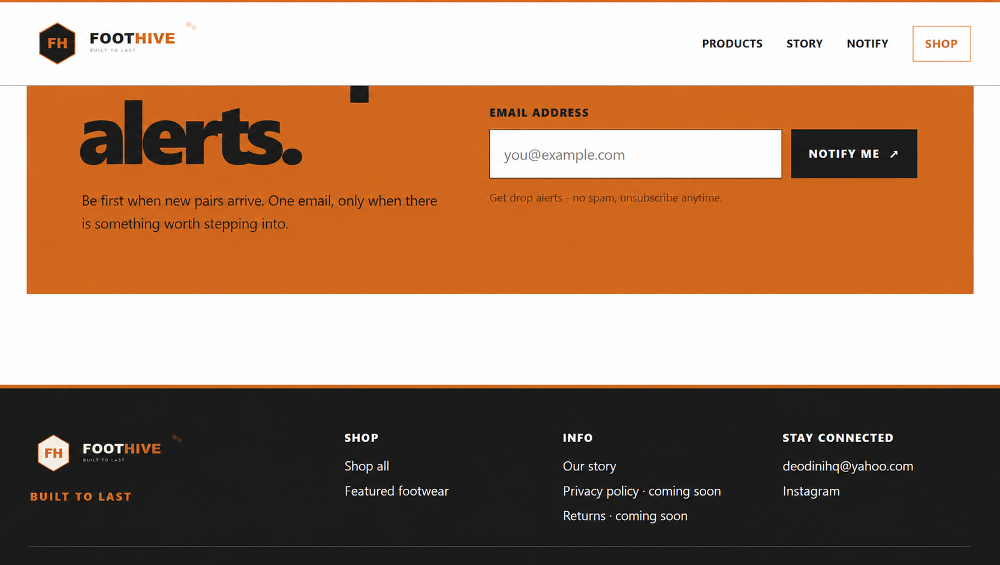
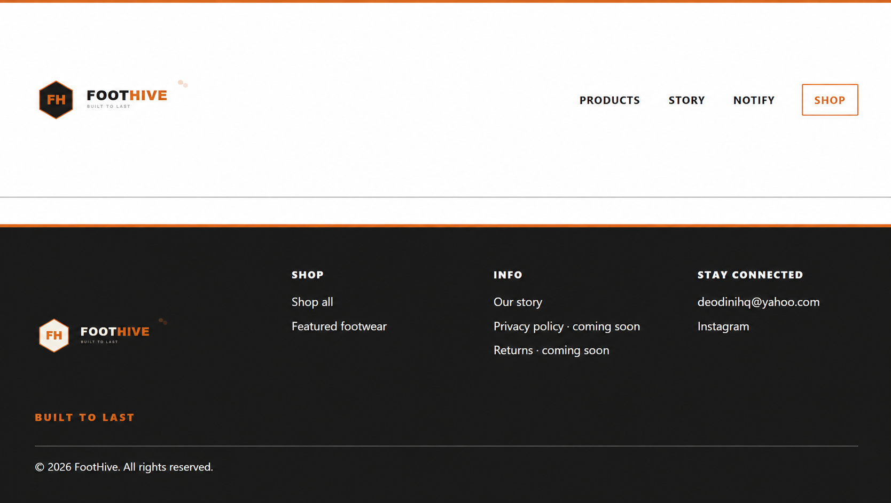

# V003 Build Report link-adaptation record

The canonical BUILD_REPORT_FH_BRAINBOX.md is a byte-identical archival copy of the V002 source. The previous navigable V003 copy had link adaptations made under F14. Those textual differences are preserved below for provenance. The evidence destinations themselves remain in EVIDENCE_FH_BRAINBOX. This file is navigational evidence, not a replacement for the source report.

```diff
--- V002 historical BUILD_REPORT
+++ previous V003 navigable BUILD_REPORT
@@ -919,9 +919,9 @@

 The screenshots were cropped to remove browser chrome, the left browser sidebar, scrollbar edge, and Windows taskbar:

-
-
-
+
+
+

 ### Decision and implementation
 Operator approved omitting explicit `width` and `height` attributes from the header and footer logo `` elements, despite the earlier T09 implementation record that added dimensions to both logos. This is a visual exception for the two logos: retain the PR #6 markup and `.brand img { height: auto; }`, which preserves the SVG ratio and compact header. Keep T09 intrinsic dimensions on all seven product images. The local preview was measured at a 1225 px viewport: header 95.3 px; logo 192 × 60 px. No Netlify deployment was used for this comparison or fix.
@@ -939,10 +939,10 @@
 | Chrome | 390 × 844 | Visible, within viewport | 1 column | Email and button visible, within page | None | Pass |
 | Chrome | 768 × 1024 | Visible, within viewport | 2 columns | Email and button visible, within page | None | Pass |
 | Chrome | 1440 × 900 | Visible, within viewport | 3 columns | Email and button visible, within page | None | Pass |
-| Edge | 320 × 780 | Visible, within viewport | 1 column | Email and button visible, within page | None | Pass ([screenshot](EVIDENCE/T11-responsive-qa/edge-320x780.png)) |
-| Edge | 390 × 844 | Visible, within viewport | 1 column | Email and button visible, within page | None | Pass ([screenshot](EVIDENCE/T11-responsive-qa/edge-390x844.png)) |
-| Edge | 768 × 1024 | Visible, within viewport | 2 columns | Email and button visible, within page | None | Pass ([screenshot](EVIDENCE/T11-responsive-qa/edge-768x1024.png)) |
-| Edge | 1440 × 900 | Visible, within viewport | 3 columns | Email and button visible, within page | None | Pass ([screenshot](EVIDENCE/T11-responsive-qa/edge-1440x900.png)) |
+| Edge | 320 × 780 | Visible, within viewport | 1 column | Email and button visible, within page | None | Pass ([screenshot](EVIDENCE_FH_BRAINBOX/T11_RESPONSIVE_QA_FH_BRAINBOX/edge-320x780.png)) |
+| Edge | 390 × 844 | Visible, within viewport | 1 column | Email and button visible, within page | None | Pass ([screenshot](EVIDENCE_FH_BRAINBOX/T11_RESPONSIVE_QA_FH_BRAINBOX/edge-390x844.png)) |
+| Edge | 768 × 1024 | Visible, within viewport | 2 columns | Email and button visible, within page | None | Pass ([screenshot](EVIDENCE_FH_BRAINBOX/T11_RESPONSIVE_QA_FH_BRAINBOX/edge-768x1024.png)) |
+| Edge | 1440 × 900 | Visible, within viewport | 3 columns | Email and button visible, within page | None | Pass ([screenshot](EVIDENCE_FH_BRAINBOX/T11_RESPONSIVE_QA_FH_BRAINBOX/edge-1440x900.png)) |

 DOM measurements in both browsers confirmed document scroll width equals its available layout width at each viewport. The support paragraph wraps inside the hero, and both hero CTAs and notify controls remain inside the viewport/page bounds.

```
