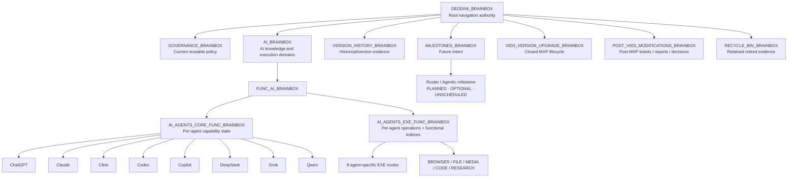
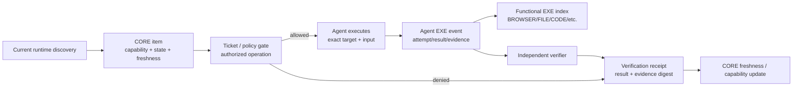
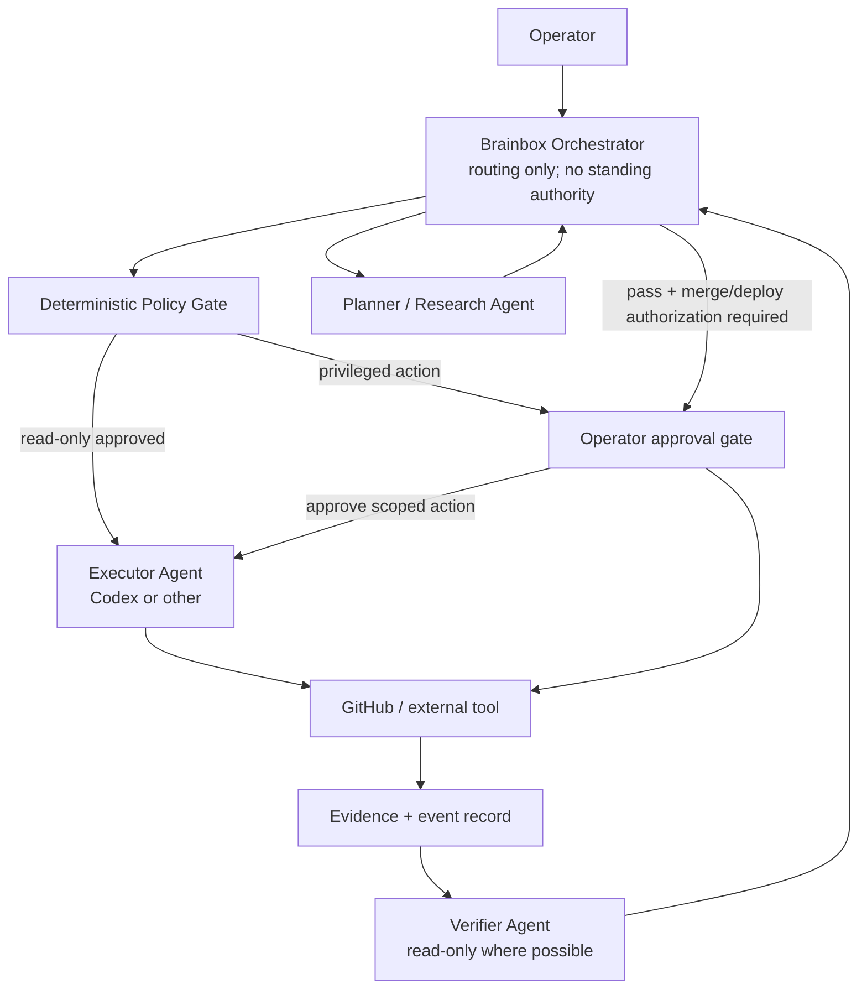
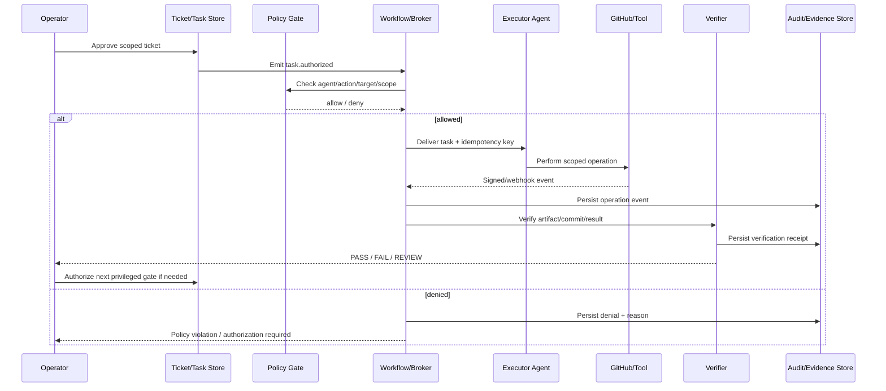
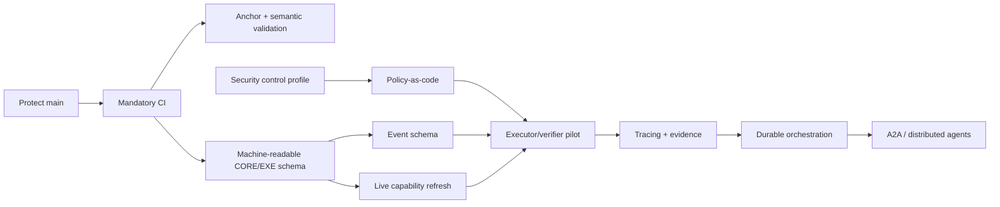
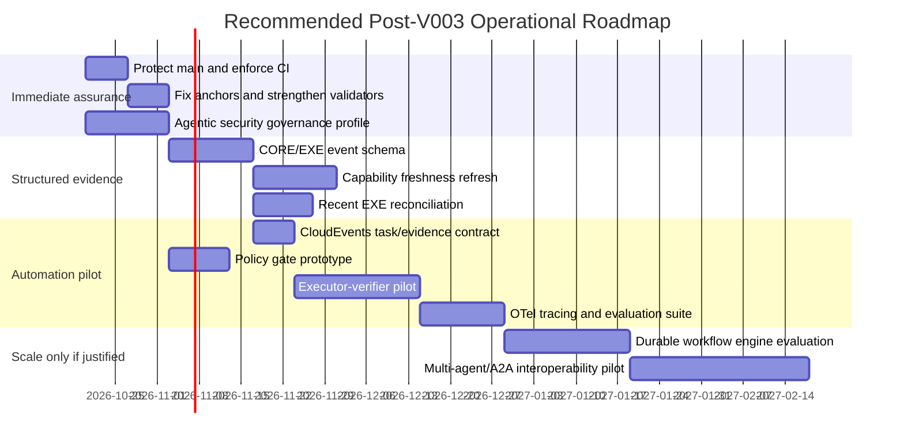
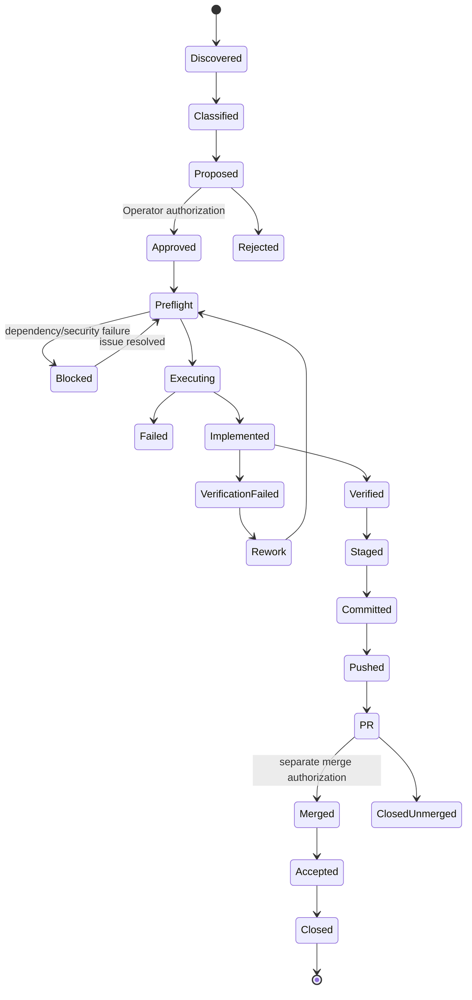

# DEODINI_BRAINBOX — Comprehensive Deep Research Category Summary

**DOCUMENT STATUS:** FULL ASSESSMENT PRESENT — FINDINGS NOT INDEPENDENTLY CERTIFIED
**DOCUMENT PURPOSE:** 14-category research scope summary and full Deep Research assessment
**SOURCE:** Operator-provided research-category summary, 2026-10-20
**INPUTTED BY:** Codex, under Operator authorization
**FULL DEEP RESEARCH REPORT:** PRESENT — FULL ASSESSMENT INSERTED; INDEPENDENT GOVERNANCE AND CITATION VERIFICATION PENDING

The Deep Research mandate can be organized into 14 major research categories, covering the project's current architecture, Governance, technology, risks, future development, and implementation strategy.

The full assessment is appended below. Its presence does not mean that its findings have been independently verified.

## Research categories

| # | Research category | Primary investigation | Expected outcome |
|---|---|---|---|
| 01 | Repository Architecture & Structure | Examine repository organization, folder hierarchy, documentation relationships, and architectural boundaries. | Verified architecture map and structural findings |
| 02 | Governance & Compliance | Assess Governance rules, approval gates, documentation standards, and operational controls. | Governance compliance assessment and corrective recommendations |
| 03 | V003 Historical Integrity | Verify V003 closure, frozen specifications, historical records, and separation from post-V003 development. | Historical integrity and lifecycle assessment |
| 04 | Post-V003 Modification Lifecycle | Review modification records, ticketing, evidence, reporting, and outstanding decisions. | Post-V003 lifecycle maturity assessment |
| 05 | AI Agent CORE Architecture | Evaluate agent definitions, capabilities, responsibilities, boundaries, and extensibility. | CORE architecture improvement plan |
| 06 | AI Agent EXE Architecture | Evaluate execution records, functional categories, traceability, and operational workflows. | EXE architecture improvement plan |
| 07 | Multi-Agent Orchestration | Research coordination between agents, delegation, task routing, shared context, and conflict resolution. | Recommended orchestration architecture |
| 08 | Automation & Workflow Engineering | Identify opportunities for repeatable automation, validation, scheduling, and workflow integration. | Automation opportunities and implementation priorities |
| 09 | Technology & Tooling Research | Compare relevant AI frameworks, development tools, integrations, and modern technical alternatives. | Technology comparison and adoption recommendations |
| 10 | Security, Privacy & Reliability | Investigate permissions, secrets, prompt injection, trust boundaries, auditability, and failure recovery. | Risk register and security improvement roadmap |
| 11 | Testing, Validation & Quality Assurance | Evaluate automated tests, structural validators, integration testing, and regression controls. | Testing strategy and quality gates |
| 12 | Performance, Scalability & Maintainability | Assess operational complexity, future growth, modularity, technical debt, and maintainability. | Scalability and maintainability recommendations |
| 13 | Gap Analysis & Risk Prioritization | Identify differences between the current repository and proposed future capabilities. | Evidence-based gap matrix and prioritized risks |
| 14 | Strategic Roadmap & Implementation Planning | Consolidate findings into sequenced improvements with dependencies, acceptance criteria, and approval requirements. | Actionable roadmap and proposed future Codex tickets |

## How the research fits together

The investigation follows this conceptual sequence:

**Current state and evidence → Architecture and operations → Technology and assurance → Gap and risk analysis → Governance-compliant future roadmap**

This sequence describes the intended research process. It does not establish that any investigation stage has been completed.

## Final research deliverables

The full investigation is intended to produce a consolidated package containing:

- Evidence-backed current-state assessment of DEODINI_BRAINBOX.
- Architecture diagrams explaining existing and proposed structures.
- Governance and historical integrity findings, including treatment of PR #90.
- CORE, EXE, orchestration, and automation recommendations.
- Technology comparison with trade-offs and adoption criteria.
- Security and quality-assurance assessments.
- Gap and risk matrices ranked by impact and urgency.
- Prioritized implementation roadmap, with dependencies and acceptance criteria.
- Proposed Codex work packages requiring separate Operator authorization.
- Ten final strategic decisions for Operator consideration.

## Important research boundaries

The investigation must preserve three distinctions:

**Historical V003:** Closed and protected. Historical records are not to be rewritten to make them match future recommendations.

**Post-V003 development:** The appropriate lifecycle for new improvements, subject to Governance and Operator approval.

**PR #90:** A separate unresolved historical branch disposition. Research may assess and recommend action, but it must not merge or close the PR.

**Overall objective:** Establish what DEODINI_BRAINBOX currently is, identify what is missing or at risk, compare credible future options, and produce a Governance-compliant plan for what should happen next.

The 14 categories above describe the planned coverage. Their findings, rankings, and recommendations remain subject to the actual Deep Research evidence.

## Full Deep Research Report — Historical Insertion Record

**STATUS:** PRESENT — INSERTED; INDEPENDENT GOVERNANCE AND CITATION VERIFICATION PENDING

**CONTENT OWNER:** Operator

**PURPOSE:** Records the original insertion boundary for the completed Deep Research assessment below.

The complete assessment is present below the original insertion marker. The marker is retained as historical context, not an outstanding task. No independent verification or Operator acceptance is implied.

**[HISTORICAL INSERTION MARKER — THE COMPLETE DEEP RESEARCH ASSESSMENT FOLLOWS]**

# DEODINI_BRAINBOX Post-V003 Deep Research Assessment

## Executive assessment

**Research baseline.** This assessment is read-only and uses the current GitHub `main` branch as of **October 19, 2026**, with `main` verified at merge commit `45d9a7f756b2bbb5f2361d887944a2edb74bf7f8`. That commit is the merge result of PR #91 and has a valid GitHub verification signature. The research scope follows the Operator's requested evidence hierarchy: repository Governance, frozen V003 authority, M05/M06 evidence, POST_V003 records, CORE/EXE, relevant PR/commit history, and primary/official external technology sources. fileciteturn38file0 fileciteturn0file0

The evidence vocabulary used throughout is:

| Label | Meaning in this report |
|---|---|
| **VERIFIED** | Directly observed in the current repository, GitHub state, or an authoritative primary source. |
| **DOCUMENTED ONLY** | The repository states it, but this research did not reproduce the underlying live/runtime behavior. |
| **HISTORICAL** | Direct evidence exists, but only for a dated earlier runtime, commit, tool session, or execution. |
| **INFERRED** | Analytical conclusion derived from verified/documented evidence; not itself a direct observation. |
| **UNVERIFIED** | A capability or condition is claimed or conceivable but lacks sufficient present evidence. |
| **NOT ASSESSED** | Outside current read-only access or deliberately not tested. |

### Executive summary

**Overall judgment: DEODINI_BRAINBOX has completed a credible documentation-and-governance MVP, but it has not yet become an operational multi-agent control plane.** The strongest parts are evidence preservation, explicit authority boundaries, state vocabulary, historical traceability, and disciplined separation of capability from execution. The weakest parts are technical enforcement, runtime freshness, automated verification coverage, and the absence of an actual durable orchestration layer. The repository itself correctly labels the Router/Agentic architecture as **PLANNED / OPTIONAL / UNSCHEDULED / SUBJECT TO SUPERSESSION**, explicitly stating that no Router, agent runtime, database, vector store, self-hosted service, or equivalent infrastructure currently exists. fileciteturn37file0

The architecture can therefore be summarized as:

> **Strong governance plane + strong documentation/evidence model + partial capability catalog + historical execution catalog + weak technical enforcement + no current orchestration runtime.**

That is not a failure of V003. It is consistent with the Operator-defined MVP boundary. The V003 active Unresolved Register currently reports **zero active corrective findings**, while also explicitly warning that an empty register does not by itself establish total implementation or technical certification. fileciteturn39file0

The post-V003 work has also been structurally integrated successfully. PR #89 merged the MOD-001/MOD-002/MOD-003 navigation work into `main` at `2ce8c1771c560465c84f3a54cdc44803794744f7`; PR #91 then merged MOD-004 at the current `main` commit `45d9a7f...`. PR #90 remains open and unmerged, and an independent current comparison shows its F02 branch at `c8005beb...` is **9 commits ahead and 13 behind** current `main`. fileciteturn32file0 fileciteturn34file0 fileciteturn33file0 fileciteturn36file0

The single most important technical risk discovered is that **GitHub `main` is currently unprotected**: GitHub reports `protected: false`, protection disabled, and no required status checks. This means the repository's sophisticated human Governance rules are not technically enforced by the source-control platform. GitHub itself documents that disabling required status checks allows collaborators with sufficient access to merge without those checks being required. fileciteturn38file0 citeturn1search9

The most important documentation/testing defect found during this research is also concrete: **all eight named-agent EXE child READMEs still reference the old `#v003-exe-questionnaire--2026-10-15` parent anchor, while that heading no longer exists in the restructured current EXE parent README.** The existing validator nevertheless reported zero findings after MOD-003/MOD-004. This demonstrates a gap between **path validation** and **Markdown fragment/semantic validation**. fileciteturn27file0 fileciteturn27file1 fileciteturn27file2 fileciteturn27file3 fileciteturn27file4 fileciteturn27file5 fileciteturn27file6 fileciteturn27file7

The next architectural goal should therefore **not** be “build autonomous agents immediately.” It should be to turn the current Governance model into **enforced, machine-readable controls around a small event-driven execution loop**. Only after that should DEODINI_BRAINBOX introduce broad autonomous multi-agent routing.

The recommended strategic sequence is:

**documentation governance → technical enforcement → current capability attestation → structured execution evidence → event-driven executor/verifier pilot → durable orchestration → multi-agent interoperability.**

That sequence preserves what V003 did well rather than replacing it.

**Architecture maturity judgment:** **DOCUMENTED/CONTROLLED MVP, not autonomous runtime.**

**Governance maturity judgment:** **High conceptual maturity; medium implementation maturity; low-to-medium machine enforcement.**

**Agent capability confidence:** **Low-to-medium overall because most live states are intentionally UNKNOWN / NOT VERIFIED; Codex has the strongest historical execution evidence.**

**Automation readiness:** **Moderate after foundational security/CI work; not yet appropriate for unsupervised write/merge/deploy automation.**

**Recommended next milestone:** **Post-V003 Operational Assurance Layer**, not a full Router.

## Architecture, governance, and CORE/EXE assessment

**Architecture assessment.** The current repository is coherent as a governed knowledge architecture. The root README acts as complete-tree/navigation authority; Governance owns reusable current rules; the frozen V003 Specification remains architectural authority; V003 Origin preserves historical decision context; Phase 02/03 retain migration/closure evidence; and the standalone `POST_V003_MODIFICATIONS_BRAINBOX` owns modifications after MVP closure. The post-V003 workspace explicitly remains separate from the frozen V003 target tree. fileciteturn29file0

A simplified current domain view is:



**VERIFIED:** this architecture reflects the current parent records and the explicitly planned Router milestone rather than claiming the Router exists. fileciteturn29file0 fileciteturn37file0

The architecture is **clean at the conceptual ownership level**. CORE and EXE now have substantially better responsibility boundaries than before MOD-001 and MOD-002. The current CORE parent distinguishes Agent CORE, Agent EXE, Functional EXE and original evidence; the current EXE parent similarly separates “what the agent appears able to do” from “what exact operation it attempted/executed.” fileciteturn28file0 fileciteturn26file0

The main scalability concern is not directory depth itself. It is **manual synchronization across many human-readable mirrors of the same underlying facts**. MOD-003 validation counted **83 READMEs, 82 local-tree blocks, 1,053 displayed tree entries and 923 Markdown targets**. That demonstrates strong structural discipline, but it also means every naming/navigation change has a large manual change surface. fileciteturn30file0

**INFERRED:** the architecture will scale better if machine-readable records become the primary operational data source while Markdown remains the human-readable generated/expository layer. This should not mean discarding the current Governance documentation. It means avoiding a future where the same agent/tool/status/event must be manually synchronized in five or six places.

### Governance maturity

The Governance layer is one of Brainbox's strongest assets.

**VERIFIED:** Ticketing Governance already encodes many practices associated with mature engineering control systems: discovery before correction, scoped authorization, dependency tracking, preflight, one coherent responsibility per ticket, acceptance criteria, independent verification, distinct stage/commit/push/PR/merge/deploy states, and preservation of no-change outcomes. fileciteturn16file0

**VERIFIED:** Evidence Governance explicitly distinguishes what was reported from what was independently reproduced, requires provenance, and rejects the idea that a suggested test equals an executed test. That principle is especially important for AI agents because a model's own textual success claim is weaker than observable side effects, repository state, logs, artifacts, or independent reproduction. fileciteturn17file6

**VERIFIED:** Documentation Governance also contains an important anti-instruction-injection principle: copied/tool-produced text does not automatically acquire authority simply because it appears in documentation; Governance, tickets and Operator decisions remain authoritative. That is directionally aligned with modern agent-security thinking. fileciteturn10file0

There are, however, two structural concerns.

First, **Governance is stronger in prose than in enforcement**. Internal rules correctly separate approval from execution, yet current GitHub `main` is technically unprotected. fileciteturn38file0

Second, the canonical Documentation Governance file contains a large **DRAFT / OPERATOR REVIEW REQUIRED** universal framework alongside active policy. **INFERRED:** although it is labeled, housing a large draft inside a canonical active policy file increases context burden and raises the chance that an AI agent will over-read proposed language as operative policy. A cleaner design would retain the draft but isolate it under a clearly separate proposal/draft path.

I would rate current Governance maturity as:

| Dimension | Rating | Finding |
|---|---:|---|
| Authority ownership | High | **VERIFIED:** Operator, Governance, Spec, historical sources and post-V003 records are separated clearly. |
| Evidence discipline | High | **VERIFIED:** historical/current/reported/verified distinctions are explicit. |
| Ticket discipline | High | **VERIFIED:** lifecycle gates and scoped execution are unusually well specified. |
| Documentation consistency | Medium-high | Strong tree/link tooling, but the stale EXE anchors prove current validators do not catch every semantic-reference defect. |
| Machine enforcement | Low-medium | **VERIFIED:** `main` is unprotected and no required status checks are enabled. fileciteturn38file0 |
| Runtime security model | Medium-low | Existing Security Governance is useful but narrower than the needs of autonomous multi-agent execution. |
| Runtime observability | Low | No current Brainbox agent-runtime telemetry plane is evidenced; planned architecture explicitly says Router/runtime infrastructure does not yet exist. fileciteturn37file0 |

### CORE assessment

The CORE mental model is excellent:

> exposure ≠ configuration ≠ connection ≠ authentication ≠ execution ≠ authorization.

That model is consistent with the frozen V003 state vocabulary and was preserved/reinforced in the post-V003 restructuring. fileciteturn17file7 fileciteturn28file0

The eight agent records, however, show that **Brainbox currently knows more about historical capability than present capability**.

| Agent | Present evidence assessment | Current execution confidence |
|---|---|---|
| ChatGPT | **HISTORICAL.** Sept. 19 report listed GitHub, Figma, Supabase, Render, Outlook and Brevo; current exposure/connection/authentication/execution are explicitly UNKNOWN / NOT VERIFIED. fileciteturn18file0 | Low |
| Claude | **HISTORICAL.** Sept. 20 source reports a broad connector set and historical RDC file operations; current runtime not checked. fileciteturn19file0 | Low |
| Cline | **HISTORICAL.** Source inventories filesystem/shell and several services; current runtime not checked; MEDIA remains reserved rather than admitted. fileciteturn20file0 | Low |
| Codex | **HISTORICAL but strongest.** Oct. 8 evidence directly covered GitHub/RDC/Git operations and task-scoped authorization. Current runtime still requires fresh verification. fileciteturn21file0 | Medium-high historically; unknown now |
| Copilot | **HISTORICAL.** Playwright/MCP configuration exists in source, but configuration was not equivalent to verified E2E browser execution. fileciteturn22file0 | Low |
| DeepSeek | **DOCUMENTED ONLY.** Approved role baseline exists; tools, connection, authentication and execution are UNKNOWN / NOT VERIFIED. fileciteturn23file0 | Very low |
| Grok | **HISTORICAL.** Several connectors reported; Playwright skill existed but direct Playwright MCP was not active. Current runtime unknown. fileciteturn24file0 | Low |
| Qwen | **DOCUMENTED ONLY.** Approved role baseline exists; live tool and execution states remain UNKNOWN / NOT VERIFIED. fileciteturn25file0 | Very low |

The parent CORE now instructs agents to answer C01–C10 using stable item IDs, yet the eight child CORE records remain in their older broad-section format because MOD-002 explicitly excluded their bodies. **DOCUMENTED ONLY:** this is not necessarily an error; it is a clear **schema-adoption gap** between the improved parent procedure and existing records. fileciteturn28file0 fileciteturn30file0

Recommended next-state CORE design:

```text
CORE item
├── core_id
├── agent_id
├── provider/runtime
├── capability/tool name
├── state.exposed
├── state.configured
├── state.connected
├── state.authenticated
├── state.executable
├── account/project/device scope
├── authorization_requirement
├── observed_at
├── freshness_expires_at
├── evidence_ref
├── evidence_digest
└── last_verifier
```

This would preserve the current conceptual model while making freshness and automation tractable.

### EXE assessment

The EXE architecture is conceptually correct: exact execution belongs to the named agent, while functional indexes provide cross-agent discovery rather than duplicating original operation evidence. fileciteturn26file0

The current Codex EXE child records four M06 operations—RESEARCH, BROWSER, FILE and CODE—as **HISTORICALLY EXECUTED**, explicitly stating that current runtime execution has not been rechecked. fileciteturn26file0

That creates an important traceability question. Codex has demonstrably performed substantial post-V003 Git work—MOD-003 and MOD-004 publication, PR creation and merging—but its agent EXE record still says **“Agent questionnaire pending; no new execution admitted.”** PR #89 and PR #91 independently verify recent repository operations. fileciteturn26file0 fileciteturn32file0 fileciteturn34file0

**INFERRED:** Brainbox needs a policy decision on whether post-V003 operational Git activity should automatically create or propose Agent EXE events. At present, the Git history proves actions occurred while EXE remains a historical M06 index. That is not falsification, but it weakens EXE as a complete operational ledger.

The intended CORE→EXE chain should become:



The critical rule is that **CORE should never infer execution; EXE should never infer standing authority; a verifier should never silently become the executor of the same privileged operation.**

## Multi-agent orchestration, automation feasibility, and industry comparison

The present Brainbox structure should be treated as a **control specification for a future orchestrator**, not as the orchestrator itself. The planned Router milestone explicitly confirms that routing, persistent memory, database/vector infrastructure, cross-system work, audit/recovery and self-hosting are future possibilities rather than present capabilities. fileciteturn37file0

### Recommended orchestration model

For DEODINI_BRAINBOX, the safest initial pattern is **manager-controlled orchestration**, not unrestricted peer-to-peer delegation.

OpenAI's current Agents SDK distinguishes two relevant patterns: “agents as tools,” in which a manager retains control and specialists perform bounded subtasks, and “handoffs,” in which a specialist takes over. The SDK notes that code-driven orchestration offers more deterministic speed/cost/performance characteristics and that manager-style orchestration is appropriate when one agent should retain final control or combine specialist outputs. citeturn5search0turn5search7

For Brainbox, that maps naturally to:



**Recommended role split:**

`Orchestrator` decides *who should work*, but cannot invent authorization.

`Executor` performs only the exact approved operation with least-privilege credentials.

`Verifier` receives evidence independently and should be read-only whenever possible.

`Policy engine` deterministically checks action type, agent, target, ticket, authorization state and environment before privileged calls.

`Operator` remains the high-impact approval principal.

This reflects Brainbox's existing Governance better than a free-form swarm.

OpenAI's handoff documentation reinforces the importance of authorization at the handoff boundary: when authorization depends on handoff inputs, it should be checked before any side effect, and ordinary function-tool guardrails do not automatically protect handoffs. citeturn5search4

### Can one AI agent reliably notify another?

**Yes—but not by assuming consumer chat sessions can “talk to each other.”** Reliable agent coordination requires an external machine-addressable control plane.

The practical options are:

1. A central orchestrator calls agent APIs.
2. A durable queue/workflow engine delivers tasks.
3. A2A connects independently hosted agent endpoints.
4. MCP connects an agent to tools/resources, not primarily to peer agents.
5. GitHub events can act as workflow triggers for repository-centric work.
6. Human-facing chat applications remain interfaces, not dependable autonomous message buses.

A2A v1.0 is now a production-oriented open agent interoperability protocol. Its official documentation positions A2A as the horizontal agent-to-agent layer and MCP as the vertical agent-to-tool/data layer. A2A supports agent discovery, authentication, long-running tasks, streaming and asynchronous operations; its 2026 v1.0 work added enterprise features including signed Agent Cards and multi-tenancy. citeturn1search0turn1search1turn1search12

This means the best future architecture is **not ChatGPT → “message an open Codex chat tab.”** It is:

> ChatGPT/planner produces a structured authorized task → durable broker/orchestrator records it → Codex worker receives it through an API/service boundary → Codex publishes result/evidence → independent verifier consumes the result.

### Secure event-driven automation design



The event envelope should use stable fields such as:

```json
{
  "specversion": "1.0",
  "type": "brainbox.exe.completed",
  "source": "agent/codex",
  "id": "uuid",
  "time": "RFC3339 timestamp",
  "subject": "POST-V003-MOD-XYZ",
  "data": {
    "operation_id": "EXE-CODEX-GIT-...",
    "ticket_id": "POST-V003-MOD-...",
    "agent_id": "codex",
    "target": "repo/ref/path",
    "authorization_ref": "...",
    "input_digest": "...",
    "result": "success|partial|failed",
    "evidence_ref": "...",
    "commit_sha": "...",
    "trace_id": "..."
  }
}
```

CloudEvents exists specifically to standardize event metadata across services and is a CNCF-graduated specification, making it a good neutral envelope instead of inventing a Brainbox-only transport format. citeturn6search0

### Automation feasibility

A minimal Brainbox automation layer is technically feasible today without implementing the entire planned Router.

A lightweight pilot could use GitHub events plus an automation engine such as Activepieces for deterministic routing, with an LLM/agent only where judgment is needed. Activepieces distinguishes deterministic flows from agents whose decisions vary per run, supports agents inside flows, webhooks, self-hosting, project-scoped connections and audit-event streaming. Its own documentation also shows an important limitation: some MCP tool activity is not represented in its audit log, so Brainbox should maintain its own operation/evidence events rather than relying exclusively on platform logs. citeturn4search0turn4search7turn4search14

For more critical, long-running workflows, Temporal offers stronger durability. Temporal persists event history so workflows can recover after worker crashes, retries activities, and explicitly requires consideration of idempotency because handlers can execute more than once. citeturn2search5turn2search11

A message broker is optional at the pilot stage. At higher scale, NATS JetStream offers durable at-least-once delivery and replay while decoupling publisher and consumer in time. citeturn6search15

### Industry and technology comparison

| Technology/pattern | Primary purpose | Fit for Brainbox | Recommendation |
|---|---|---|---|
| **OpenAI Agents SDK** | In-process agent orchestration, manager/tool agents, handoffs, guardrails, tracing and deterministic workflow tests. citeturn5search0turn5search1turn5search2 | Very good for planner/executor/verifier logic where OpenAI-based agents are used. | **Adopt selectively** after policy/evidence foundations. Use manager-style orchestration first. |
| **LangGraph** | Stateful graph workflows, durable execution, explicit nodes/errors and human interrupts. citeturn2search12 | Strong match for explicit Brainbox states and human approval gates. | **Pilot option** if graph/state-machine transparency is preferred. |
| **Temporal** | Durable multi-step workflows, replay, retries, long waits and recovery. citeturn2search5turn2search11 | Excellent medium-term control plane for high-value long-running automation. | **Recommended medium term**, not necessary for first proof of concept. |
| **MCP** | Standard agent/model-to-tool/resource integration. Current implementations include OAuth-oriented authorization models and increasingly explicit authorization hardening. citeturn2search0turn2search3turn2search14 | Directly compatible with CORE's connector/tool inventory model. | **Use**, but do not confuse connection with authorization—Brainbox already gets this right. |
| **A2A v1.0** | Standard remote agent discovery, communication and delegation across frameworks/vendors. citeturn1search0turn1search1 | Valuable once Brainbox has actual network-addressable agent services. | **Future adoption**, not immediate priority. |
| **CloudEvents** | Common event envelope independent of transport. citeturn6search0 | Excellent for EXE/ticket/verification event contracts. | **Adopt early** for event schema. |
| **NATS JetStream** | Lightweight durable event/message broker with replay. citeturn6search15 | Good once asynchronous workers become real. | **Optional near/medium term**. |
| **Activepieces** | Low-code flows, webhooks, agents and broad app connectivity. citeturn4search0turn4search13 | Fastest path for a small proof-of-concept workflow. | **Good pilot platform**, but Brainbox evidence must remain canonical. |
| **OPA** | General-purpose policy-as-code decision engine using structured input. citeturn3search2 | Excellent match for translating Operator/Governance rules into deterministic allow/deny decisions. | **Strong recommendation** once action policies stabilize. |
| **OpenTelemetry** | Vendor-neutral traces, metrics, logs and context propagation; current GenAI conventions support agent/tool-call tracing. citeturn6search4turn3search5 | Strong fit for cross-agent execution observability. | **Recommended before production automation**. |

The key architectural conclusion is **not to choose one framework to “be Brainbox.”** Brainbox should own its **policy, identity, evidence and event contracts**, while frameworks remain replaceable execution components.

## Security, authority, and verification gap analysis

The present Security Governance correctly prohibits secret commits and makes an important distinction between technical access and permission. That is a solid base. But a future agentic runtime requires much more than secret hygiene. Modern agent-security guidance emphasizes prompt/goal hijacking, tool misuse, excessive agency, identity/privilege abuse, unexpected code execution, memory/context poisoning and cascading failures. OWASP's 2026 agent-security work specifically stresses that the risk shifts from “what a model can say” toward “what a system can do” once agents receive tools and permissions. citeturn3search0turn3search1

### Prioritized security and authority risk matrix

| Priority | Risk | Evidence state | Likelihood | Impact | Assessment / required control |
|---|---|---|---|---|---|
| **P0** | `main` has no technical branch protection or required status checks | **VERIFIED** | High | Critical | GitHub reports protection disabled. Enable ruleset/branch protection, PR requirement and required validation checks. fileciteturn38file0 |
| **P0** | Human Governance can be bypassed by any sufficiently privileged technical credential | **INFERRED** | Medium-high | Critical | Internal approval language is strong, but enforcement currently depends on agent/person discipline rather than repository controls. Use least privilege and deterministic authorization. |
| **P0** | Future agent connectors may inherit more privileges than the ticket authorizes | **INFERRED** | High once automated | Critical | Enforce action-level allowlists, short-lived credentials, target restrictions and policy evaluation. OWASP flags excessive agency/tool misuse as core agent risks. citeturn3search0turn3search1 |
| **P1** | Most CORE live states are stale/unknown | **VERIFIED** | High | High | Seven of eight records have mainly historical or role-only evidence; even Codex evidence is dated. Introduce freshness TTLs and current attestations. fileciteturn18file0 fileciteturn19file0 fileciteturn21file0 |
| **P1** | All eight named-agent EXE children contain stale questionnaire anchors | **VERIFIED** | Certain | Medium | Fix links and extend validator to validate fragments, not only target files. fileciteturn27file0 fileciteturn27file1 fileciteturn27file2 fileciteturn27file3 fileciteturn27file4 fileciteturn27file5 fileciteturn27file6 fileciteturn27file7 |
| **P1** | Structural validator can return zero findings while semantically broken anchors remain | **VERIFIED / INFERRED** | High | High | Expand tests to heading fragments, duplicate IDs, canonical owners, status freshness and machine schemas. |
| **P1** | Prompt/tool-output injection may influence privileged agent decisions | **INFERRED** | Medium-high | High | Treat web, tool, issue, PR and document content as untrusted data; never let content grant authority. Add taint/trust classification and deterministic policy gates. |
| **P1** | Runtime execution and verification evidence can drift away from EXE | **DOCUMENTED ONLY / INFERRED** | High | High | Recent Codex Git activity is proven in GitHub while agent EXE still contains only M06 historical entries. Define automatic EXE-event proposal rules. fileciteturn26file0 fileciteturn32file0 fileciteturn34file0 |
| **P2** | CORE C01–C10 parent contract is not yet reflected in eight child records | **DOCUMENTED ONLY** | High | Medium | Migrate gradually to structured IDs rather than forcing a large rewrite. fileciteturn28file0 fileciteturn30file0 |
| **P2** | PR #90 remains diverged and non-mergeable | **VERIFIED** | Certain | Medium | Current compare is 9 ahead / 13 behind; preserve unique history, then close without merging if final reconciliation proves main contains canonical state. fileciteturn33file0 fileciteturn36file0 |
| **P2** | Draft policy embedded in canonical policy context could confuse agents | **VERIFIED / INFERRED** | Medium | Medium | Move large draft frameworks to a clearly isolated proposals/drafts domain while preserving links/history. |
| **P2** | Public repository may expose future operational metadata even without secrets | **VERIFIED / INFERRED** | Medium | High if sensitive runtime data grows | Confirm public visibility is intentional and define data-classification/redaction rules before storing execution telemetry. |
| **P3** | Over-documentation may increase synchronization burden and stale-state probability | **INFERRED** | High | Medium | Generate repetitive navigation/status views from machine-readable state rather than manually duplicating them. |

GitHub's own ruleset documentation supports making required status checks an enforceable merge condition, while GitHub Actions OIDC can provide short-lived cloud authentication without storing long-lived deployment credentials in repository secrets. citeturn1search9turn4search9

### Verification and testing gaps

The current validator is valuable; it should be retained. The research found that its coverage is primarily structural rather than sufficient for runtime confidence.

A future validation stack should contain five distinct layers:

| Layer | What it proves | Brainbox current state |
|---|---|---|
| **Static repository structure** | Paths, required tree structure, local references, naming/status syntax | **VERIFIED strong** — existing validator and tests. |
| **Markdown semantic integrity** | Fragment anchors, duplicate headings, canonical references, stale links | **PARTIAL** — stale eight-agent EXE anchors survived zero-finding validation. |
| **Governance schema validation** | Ticket IDs, state transitions, authorization references, evidence completeness | **PARTIAL / mostly prose-driven** |
| **Agent workflow unit/eval tests** | Routing, policy rejection, retries, handoffs, tool selection, verifier behavior | **NOT ASSESSED / runtime not yet implemented** |
| **Live integration tests** | Current credentials, account scopes, tool execution, side-effect correctness | **Mostly UNVERIFIED** by current CORE records |

OpenAI's Agents SDK now supports deterministic provider-neutral workflow testing for tool execution, handoffs, guardrails, retries and session behavior without issuing live model/network requests; equivalent deterministic tests should be required before Brainbox automation can become privileged. citeturn5search1

Recommended test taxonomy:

```text
tests/
├── governance/
│   ├── ticket_schema
│   ├── status_transition
│   ├── authorization_scope
│   └── evidence_contract
├── docs/
│   ├── path_links
│   ├── heading_fragments
│   ├── canonical_owner
│   └── generated_tree_drift
├── orchestration/
│   ├── route_selection
│   ├── deny_unauthorized_action
│   ├── retry_idempotency
│   ├── executor_verifier_separation
│   └── human_interrupt
├── security/
│   ├── prompt_injection
│   ├── malicious_tool_output
│   ├── privilege_escalation
│   ├── target_allowlist
│   └── secret_redaction
└── integration/
    ├── github_read
    ├── github_branch_write_sandbox
    ├── webhook_signature
    └── evidence_receipt
```

The security tests should include adversarial prompt/tool-output scenarios. OWASP's current assurance work explicitly includes prompt injection, indirect prompt injection, excessive agency, tool misuse, data exfiltration and human-gated guardrail validation as relevant agentic test scenarios. citeturn3search0

## Architectural recommendations, options, and effort estimates

The right architectural question is **not “Which agent framework should DEODINI_BRAINBOX adopt?”** It is:

> **Which parts must Brainbox own permanently, and which parts should remain swappable?**

Brainbox should permanently own:

**Identity and scope:** agent ID, runtime, environment, account/project/device context.

**Authority:** Operator/ticket/policy decision.

**Capability state:** CORE.

**Execution record:** EXE.

**Evidence:** source refs, digests, timestamps, verification receipts.

**Event contract:** machine-readable task/execution/verification envelope.

**Lifecycle:** proposed → authorized → executing → executed → verified → accepted/published.

**Security policy:** deterministic allow/deny boundaries.

The LLM provider, agent framework, queue, workflow engine and observability backend should remain replaceable.

### Orchestration options

| Option | Description | Benefits | Weaknesses | Recommendation |
|---|---|---|---|---|
| **A — Documentation-only continuation** | Keep agents human-invoked; improve READMEs and records only. | Lowest cost/risk; preserves current success. | Does not achieve automatic coordination or fresh runtime state. | Suitable only if automation is not a current business priority. |
| **B — Lightweight workflow pilot** | GitHub + CloudEvents schema + Activepieces/small Python service + agent API + verifier + human gates. | Fastest learning, modest infrastructure, maps well to existing tickets. | Limited durability/scaling unless hardened later. | **Recommended next architecture.** |
| **C — Durable workflow control plane** | Temporal or equivalent + policy engine + agent workers + event/evidence store + OTel. | Strong retries, recovery, human waiting, long-running tasks and auditability. | More engineering/operations overhead. | **Recommended after B proves value.** |
| **D — Full distributed multi-agent network** | A2A services, MCP tools, broker, router, memory/vector systems, autonomous specialists. | Maximum interoperability/scalability. | Highest attack surface, operational complexity and cost; exceeds demonstrated need. | **Defer.** |

### Machine-readable state without creating another documentation bureaucracy

The most important structural recommendation is a small **Brainbox Operational Manifest**, for example:

```text
BRAINBOX_RUNTIME/
├── agents.yaml
├── capabilities.jsonl
├── operations.jsonl
├── policies/
├── schemas/
└── generated/
```

This should **not** become a second manual authority tree.

The design principle should be:

> **Humans author policy and approved facts once; automation generates repetitive indexes/views.**

For example, an EXE JSONL operation event could generate the short functional EXE index automatically while the detailed human narrative remains available in the agent EXE or modification report.

### Policy-as-code

Brainbox's existing authorization model translates naturally to policy-as-code. OPA is explicitly designed to decouple policy decision-making from enforcement and accepts structured data to return policy decisions. citeturn3search2

A Brainbox policy request could be:

```json
{
  "agent": "codex",
  "operation": "git.merge",
  "environment": "production",
  "target": "DeOdini/DEODINI_BRAINBOX:main",
  "ticket": {
    "id": "POST-V003-MOD-005",
    "approved": true,
    "merge_authorized": false
  },
  "evidence": {
    "validation_passed": true,
    "independent_review": false
  }
}
```

The result should be deterministic:

```json
{
  "allow": false,
  "reason": "merge_authorized=false"
}
```

The model may explain policy. It should **not decide whether policy applies** when the decision can be deterministic.

### Credential architecture

For automated GitHub/cloud workflows, prefer:

- GitHub Apps or tightly scoped tokens rather than broad personal tokens.
- Read-only verifier credentials.
- Separate executor and verifier identities.
- Short-lived OIDC credentials for external deployments where supported.
- Per-environment service accounts.
- Explicit egress/target allowlists.
- No secret values inside model context unless strictly necessary.
- Reversible/staged operations before irreversible ones.

GitHub documents OIDC as a mechanism to obtain short-lived external credentials and notes that granting `id-token: write` permits requesting the OIDC token without itself granting write access to other resources. citeturn4search9turn4search12

### Observability architecture

Brainbox should define a trace correlation chain:

```text
ticket_id
  → task_id
    → trace_id
      → agent_run_id
        → operation_id
          → tool_call_id
            → commit/deployment/artifact
              → verification_id
```

OpenTelemetry supports traces, metrics, logs and baggage, and its GenAI conventions can represent model and tool-call activity. OpenAI's Agents SDK can also trace model calls, tool calls, handoffs and guardrails, and supports custom trace processors. citeturn6search4turn3search5turn5search2

Sensitive prompt/completion contents should **not** automatically be exported. Brainbox should log identities, hashes, states and results by default, and capture full content only where evidence requirements justify it.

### Effort and budget planning ranges

These are **planning estimates, not vendor quotations**. They assume one competent engineer/technical Operator familiar with the repository, reuse of existing GitHub, and incremental implementation rather than a greenfield platform.

| Package | Indicative effort | Indicative recurring infrastructure/tool spend | Outcome |
|---|---:|---:|---|
| Repository assurance hardening | **3–7 engineer-days** | **$0–$200/month** | Protected main, CI checks, anchor validator, status/schema checks |
| CORE/EXE machine schema + freshness | **5–12 engineer-days** | **$0–$300/month** | Structured capability/execution records, generated views |
| Security Governance expansion + policy prototype | **5–10 engineer-days** | **$0–$500/month** | Agentic security profile, OPA-style policy gate |
| Event-driven two-agent pilot | **10–25 engineer-days** | **$100–$2,000/month** depending model/API usage | Planner/executor/verifier loop with human gates |
| Durable orchestration platform | **20–50 engineer-days** | **$250–$5,000+/month** depending deployment and run volume | Long-running resilient workflows, queues, OTel, recovery |
| Full distributed agent platform | **40–120+ engineer-days** | **$500–$10,000+/month** depending providers/scale | A2A/MCP services, router, memory, multi-environment runtime |

The biggest cost uncertainty is not orchestration software; it is model/API usage, execution workload, observability retention, and the number of connected external systems.

## Prioritized backlog and roadmap

### Ten highest-value next actions

| Rank | Action | Why now | Success criterion |
|---:|---|---|---|
| **1** | **Protect `main` technically.** Require PRs, required checks, prevent accidental/direct merges as appropriate. | Current `main` is verified unprotected; this is the largest gap between Governance and enforcement. fileciteturn38file0 | Unauthorized/direct publication path is technically constrained. |
| **2** | **Make existing Governance validation mandatory CI.** | Tests currently matter only because agents/operators voluntarily run them. | Every merge candidate automatically executes the 13 tests and full validator. |
| **3** | **Add Markdown fragment/anchor validation and fix the eight stale EXE links.** | Research found a real defect missed by the current zero-finding validator. fileciteturn27file0 fileciteturn27file1 fileciteturn27file2 fileciteturn27file3 fileciteturn27file4 fileciteturn27file5 fileciteturn27file6 fileciteturn27file7 | Broken fragments fail CI. |
| **4** | **Define a machine-readable CORE/EXE/event schema.** | Existing prose model is good but costly to synchronize and difficult to automate. | Versioned schema validated in CI; no duplicate manual operational ledger. |
| **5** | **Introduce capability freshness/expiry rules and run a controlled live CORE refresh.** | Most agent records are historical/unknown. | Each important capability has `observed_at`, scope, evidence and freshness status. |
| **6** | **Decide how recent real operations enter Agent EXE.** | GitHub proves post-V003 Codex operations while Codex EXE still contains only M06 historical operations. fileciteturn26file0 fileciteturn34file0 | Every qualifying operation has one canonical EXE event or an explicit exclusion rule. |
| **7** | **Expand Security Governance for agentic execution.** | Current secret/authority principles are sound but insufficient for autonomous tools. | Policy covers prompt/tool injection, privilege, target allowlists, signed events, sandboxing, emergency stop, reversible actions and credential lifecycle. |
| **8** | **Build one constrained executor→verifier automation pilot.** | Proves orchestration without committing to a full Router. | One ticket can move from authorization to execution to independent verification with no autonomous merge. |
| **9** | **Add policy-as-code and trace correlation to the pilot.** | Converts prose authority into enforceable decisions and makes every operation inspectable. | `ticket_id → trace → agent → tool → artifact → verification` is reconstructable. |
| **10** | **Resolve PR #90 as historical branch debt.** | It remains open, non-mergeable and 9 ahead/13 behind current main. fileciteturn33file0 fileciteturn36file0 | Unique historical evidence is preserved canonically and PR #90 can be closed without merging if reconciliation supports it. |

### Dependency graph



### Roadmap



### Ticket lifecycle target

The present ticketing model should be preserved but given machine-enforceable states.



The key improvement is that the lifecycle machine should reject illegal transitions. An agent should not be able to infer `Approved → Merged` merely because it possesses a GitHub credential.

### Automation boundary

**Automate without routine human confirmation:**

Static validation, reference checking, tree generation, evidence hashing, runtime-read capability discovery where explicitly safe, ticket-state synchronization, trace generation, read-only verification, branch comparison, duplicate detection, stale-evidence alerts, test execution, artifact checksums and routine notifications.

**Keep human approval for:**

External messages sent as the Operator, repository merge to protected `main`, deployment to production, credential/security changes, destructive actions, migrations, payments, publication of sensitive data, new persistent integrations, policy exceptions and expansion of an agent's target/permission scope.

That boundary is consistent with Brainbox's existing task-specific authorization philosophy and with modern agent-security guidance on excessive agency. citeturn3search1turn3search6

## Open questions, decisions required, and direct research answers

### Decisions the Operator should make before a full Router

| Decision | Why it matters | Recommended default |
|---|---|---|
| Is the GitHub repository intentionally public long-term? | Future CORE/EXE telemetry may contain operational metadata even without secrets. | **Confirm explicitly before richer telemetry is added.** |
| Should all real agent operations be admitted to Agent EXE, or only selected evidence-bearing operations? | Current Git activity and EXE can diverge. | Record every material external/write operation as a compact machine EXE event; keep detailed narratives only where useful. |
| How long is a capability “current”? | CORE currently distinguishes historical/current but does not have universal expiry semantics. | Define TTL by risk: e.g. read-only connector longer; privileged/write connector much shorter. |
| Is Codex intended to remain the primary repository executor? | M05/M06 evidence currently makes Codex uniquely strong. | Start pilot with Codex executor; do not assume the same authority for other agents. |
| Should ChatGPT act as planner/verifier, executor, or both? | Separation of duties affects evidence independence. | Prefer planner/research/verifier roles; use separate executor identity for privileged operations. |
| Which automation platform should pilot first? | Avoid premature durable-platform investment. | Small Python service or Activepieces for pilot; Temporal only when durable long-running workflows are demonstrated as necessary. |
| Is A2A an immediate requirement? | A2A is useful only when agents actually exist as interoperable service endpoints. | **No. Defer.** |
| Should existing Markdown remain canonical? | Manual duplication will increase with runtime events. | Governance prose remains canonical policy; operational state should become machine-readable and Markdown views generated where repetitive. |
| What constitutes independent verification? | Same-agent self-check can accidentally be treated as independence. | Different execution identity/process with read-only verification whenever feasible. |
| What becomes the next formal post-V003 scope? | Prevent uncontrolled implementation of the entire planned Router. | “Operational Assurance Layer” covering protection, CI, schemas, security and one executor/verifier pilot. |

### Direct answers to the research questions

**Is the architecture clean, scalable and technically sound?**  
**INFERRED: yes conceptually, partially operationally.** Domain ownership is clear and technically sensible, but scalability will suffer if operational state continues to be duplicated manually across many Markdown surfaces. It is a strong information architecture, not yet a production agent architecture.

**Is Governance too complex?**  
**INFERRED: it is detailed rather than fundamentally over-designed.** The evidence/ticket/authority distinctions should be preserved. What should be simplified is repeated prose and manual synchronization, not the safety principles. Machine-readable policy/state plus generated views will reduce complexity without reducing control.

**Are CORE and EXE enough?**  
**No.** They are excellent foundations, but they need current capability freshness, stable machine IDs, operation-event ingestion, stronger verifier semantics and clearer runtime identity. Most live CORE states remain unverified, and post-V003 execution is not comprehensively represented in Agent EXE. fileciteturn18file0 fileciteturn21file0 fileciteturn26file0

**How should reliable multi-agent execution be coordinated?**  
Use a central task/orchestration layer, deterministic policy gate, scoped executor, independent verifier, durable task IDs, idempotency keys, explicit authorization references and structured evidence. Begin manager-controlled rather than peer-autonomous. OpenAI's documented manager/tool pattern and code-driven orchestration are especially compatible with this model. citeturn5search0

**Can one agent reliably notify another?**  
Yes, through an API, orchestrator, event broker or A2A service—not by relying on consumer chat sessions to discover and message each other. A2A is now explicitly designed for remote agent discovery/delegation, while MCP serves agent-to-tool integration. citeturn1search0turn1search12

**How should ChatGPT inform Codex that work is ready?**  
The best Brainbox-specific pattern is a **structured task record/event**, not conversational copy/paste. ChatGPT produces a proposal or approved task reference; the orchestrator checks authorization; Codex receives the task by service/API/workflow; its result becomes EXE/evidence; a verifier confirms it. GitHub can remain the repository-centric artifact system, but GitHub itself should not be the only authority store.

**What should be automated versus human-confirmed?**  
Automate deterministic validation, evidence collection, status synchronization, safe read-only discovery, retries and notifications. Require human confirmation for privilege expansion, external publication, merges, production deploys, destructive actions, credential changes and policy exceptions.

**What controls prevent overreach?**  
Least-privilege credentials, separate executor/verifier identities, protected branches, required CI, target allowlists, deterministic policy-as-code, scoped/short-lived tokens, signed webhook/event verification, sandboxing, restricted egress, idempotency, immutable evidence receipts, reversible workflows, explicit human gates and tests against prompt/tool injection. GitHub OIDC and policy engines such as OPA are suitable building blocks. citeturn4search9turn3search2

**What new tooling is actually needed?**  
Immediately: GitHub enforcement/CI, fragment validation and structured schemas. Near term: event envelope, policy engine, observability and one workflow/orchestrator. Later, only if justified: durable workflow infrastructure, message broker, A2A, persistent memory/vector infrastructure. A full Router, vector database or distributed agent mesh is **not** required to improve Brainbox materially today. This is consistent with the repository's own explicit classification of that architecture as optional and unscheduled. fileciteturn37file0

**What are the ten highest-value next actions?**  
They are, in priority order: protect `main`; enforce CI; fix/validate Markdown anchors; create machine-readable CORE/EXE schemas; establish capability freshness; reconcile real operations into EXE; expand agentic Security Governance; pilot executor→verifier automation; add policy-as-code plus tracing; and reconcile/close PR #90 without merging once unique historical evidence is safely dispositioned.

## Source and evidence register

The report deliberately distinguishes repository authority from external technology guidance.

| Evidence | Classification | How used |
|---|---|---|
| Current GitHub `main`, `45d9a7f756b2bbb5f2361d887944a2edb74bf7f8` | **VERIFIED** | Current baseline; confirms PR #91 merge result and branch-protection state. fileciteturn38file0 |
| Root `README_BRAINBOX.md` | **VERIFIED** | Current architecture/navigation, post-V003 status, validation baseline and V003 lifecycle routing. |
| `V003_UNRESOLVED_BRAINBOX.md` | **VERIFIED** | Zero active corrective findings as of Oct. 19; importantly, explicitly does not claim blanket closure/technical certification. fileciteturn39file0 |
| Frozen V003 Specification | **HISTORICAL/CANONICAL ARCHITECTURE AUTHORITY** | State vocabulary, approved role baselines and target architecture. fileciteturn17file7 |
| V003 Phase 02 M05/M06 tickets | **HISTORICAL** | CORE migration and EXE admission/evidence model. fileciteturn16file0 |
| Current CORE parent | **VERIFIED DOCUMENTATION** | Current routing, state vocabulary, C01–C10 and CORE/EXE ownership. fileciteturn28file0 |
| ChatGPT CORE | **HISTORICAL LIVE STATE** | Historical connector claims; current runtime unknown. fileciteturn18file0 |
| Claude CORE | **HISTORICAL LIVE STATE** | Historical integrations/RDC; current runtime unknown. fileciteturn19file0 |
| Cline CORE | **HISTORICAL LIVE STATE** | Historical tools; reserved MEDIA boundary. fileciteturn20file0 |
| Codex CORE | **HISTORICAL EXECUTION EVIDENCE** | Strongest historical GitHub/RDC/Git evidence and four admitted categories. fileciteturn21file0 |
| Copilot CORE | **HISTORICAL / UNVERIFIED BROWSER** | Configured Playwright not treated as verified execution. fileciteturn22file0 |
| DeepSeek CORE | **DOCUMENTED ONLY** | Approved role baseline; live integration unknown. fileciteturn23file0 |
| Grok CORE | **HISTORICAL** | Historical connector claims; Playwright skill/direct-MCP distinction. fileciteturn24file0 |
| Qwen CORE | **DOCUMENTED ONLY** | Approved role baseline; live integration unknown. fileciteturn25file0 |
| Codex EXE child | **HISTORICAL** | M06 four operations and “no new execution admitted” present state. fileciteturn26file0 |
| Eight named-agent EXE search results | **VERIFIED** | Demonstrates stale `#v003-exe-questionnaire--2026-10-15` references in all eight child READMEs. fileciteturn27file0 fileciteturn27file1 fileciteturn27file2 fileciteturn27file3 fileciteturn27file4 fileciteturn27file5 fileciteturn27file6 fileciteturn27file7 |
| POST_V003 workspace README | **VERIFIED** | Confirms standalone post-MVP lifecycle and MOD-003 precedence. fileciteturn29file0 |
| POST_V003 modification report | **VERIFIED DOCUMENTATION** | MOD-001–004 rationale, exclusions, validation and publication evidence. fileciteturn30file0 |
| PR #89 | **VERIFIED** | MOD-003 merged; merge SHA `2ce8c177...`. fileciteturn32file0 |
| PR #90 | **VERIFIED** | Open/unmerged/non-mergeable historical F02 branch. fileciteturn33file0 |
| Current `main...F02` comparison | **VERIFIED** | 9 commits ahead / 13 behind; branch remains diverged. fileciteturn36file0 |
| PR #91 | **VERIFIED** | MOD-004 merged; exact four-file scope; current merge SHA. fileciteturn34file0 |
| Router/Agentic milestone | **VERIFIED DOCUMENTATION / PLANNED** | Confirms no current Router/runtime/database/vector infrastructure and optional/unscheduled status. fileciteturn37file0 |
| GitHub ruleset documentation | **PRIMARY EXTERNAL** | Basis for branch/status-check enforcement recommendation. citeturn1search9 |
| GitHub OIDC documentation | **PRIMARY EXTERNAL** | Short-lived workflow identity/credential recommendation. citeturn4search9turn4search12 |
| OpenAI Agents SDK orchestration/testing/tracing | **PRIMARY EXTERNAL** | Manager/handoff comparison, deterministic workflow tests and observability design. citeturn5search0turn5search1turn5search2 |
| MCP official project documentation | **PRIMARY EXTERNAL** | Tool/resource integration and modern authorization direction. citeturn2search0turn2search3turn2search14 |
| A2A official protocol documentation | **PRIMARY EXTERNAL** | Agent-to-agent service interoperability and async delegation model. citeturn1search0turn1search1turn1search12 |
| Temporal official documentation | **PRIMARY EXTERNAL** | Durable workflow, event-history, retry and idempotency comparison. citeturn2search5turn2search11 |
| LangGraph official documentation | **PRIMARY EXTERNAL** | Stateful graphs, durable execution and human interrupts. citeturn2search12 |
| CloudEvents | **PRIMARY EXTERNAL** | Neutral event-envelope recommendation. citeturn6search0 |
| OpenTelemetry | **PRIMARY EXTERNAL** | Cross-agent traces, logs, metrics and GenAI observability. citeturn6search4turn3search5 |
| Open Policy Agent | **PRIMARY EXTERNAL** | Deterministic policy-as-code control recommendation. citeturn3search2 |
| OWASP GenAI/agentic security | **PRIMARY SECURITY GUIDANCE** | Prompt injection, excessive agency, privilege/tool misuse and adversarial-test recommendations. citeturn3search0turn3search1 |
| Activepieces official documentation | **PRIMARY EXTERNAL** | Lightweight automation/agent pilot comparison and audit limitations. citeturn4search0turn4search14 |
| NATS JetStream | **PRIMARY EXTERNAL** | Optional durable event-broker comparison. citeturn6search15 |

**Final assessment:** **DEODINI_BRAINBOX is more mature as a governed AI knowledge/evidence system than as an AI execution system.** That is a strong position from which to proceed. The repository should **retain** the current CORE/EXE distinction, evidence discipline, ticket gates, historical preservation and Operator authority model; **refine** them with machine-readable schemas, freshness semantics, semantic validators and technical Git enforcement; **extend** them first with a narrowly scoped executor/verifier event loop; and **avoid** premature autonomous swarms, unrestricted cross-agent credentials, direct chat-session-to-chat-session automation, or a full Router/database/vector stack before a concrete operational need proves those components necessary. The current planned Router record itself supports this conservative interpretation: it is an optional future direction, not an obligation created by V003. fileciteturn37file0